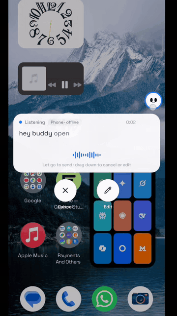

# Mina

**An AI assistant on your phone: say what you need, and it works your apps and the web until it's done.**

It works on a hidden background screen, so you can keep using your phone.

English · (docs/readme/README.ja.md) · 
 

## Get things done with one sentence

<table>
<tr>
<td align="center" width="50%">
 <b>"Order milk on Zepto with my saved address"</b> Adds the milk, uses the saved address, picks cash on delivery and checks out (recorded on a real phone)</td>
<td align="center" width="50%">
 <b>"Open LinkedIn and apply for product manager jobs"</b> Said out loud on the home screen; Mina opens LinkedIn and starts the job search in the background</td>
</tr>
</table>

## Why Mina

| | |
|---|---|
| 📱 **Leaves your screen alone** | Opens apps, taps, types and scrolls on a separate background screen while you use your phone as usual; tap the small live view whenever you want to watch |
| 🧩 **Works with any app** | Looks at the screen and finds buttons the way a person does: no app APIs, no per-app integration |
| 🌐 **Call it from any web page** | In the built-in browser, say what you want on the page you're reading and it works right there; touch the page and it stops |
| 🧠 **Gets better with use** | Remembers the preferences you tell it, and turns tasks it finishes into skills so next time is faster and steadier |
| 🔒 **Your data stays on your phone** | There is no Mina server; use your own model API key, or sign in with a ChatGPT, xAI or OpenRouter account |
| 🆓 **Open source and free** | Apache-2.0, all code public |

## Get started in three steps

1. **Install**: download the APK from [Releases](https://github.com/meenaispeaks6-droid/meena/releases/latest).
2. **Connect a model**: in Settings › Model, pick a provider and enter an API key, or just sign in with an account ([models and sign-in](docs/models.en.md)).
3. **To operate phone apps**: follow the "Set up phone control" wizard in Settings and pair wireless debugging on the phone once ([setup guide](docs/setup-guide.en.md)). Skip this if you only want chat, web and files.

Then try saying: "Set alarms for 9:40 and 10:00 tomorrow morning" or "Check the weather at 8 every morning and tell me only if it will rain".

> 💡 Have a computer handy? Send this to the AI agent on it and it will set everything up for you: 
> `Follow https://github.com/meenaispeaks6-droid/meena/blob/main/docs/install-with-agent.en.md to install Mina on the Android phone connected over USB.`

## What it can do

| | |
|---|---|
| **Operate apps** | Reads long lists and chat histories, taps and types, shares text into apps; hands logins, verification codes and payments to you |
| **Browse the web** | A built-in desktop-class browser that keeps you signed in, reads pages, downloads and uploads; paces itself and hands block pages to you |
| **Your current screen** | Double-tap the floating capsule to send the screen you're looking at: "how should I reply?", "note this down" |
| **Schedules and conditions** | "Remind me at 9 tomorrow", "do this every Friday"; runs on time in the original conversation |
| **Jump in or stop anytime** | Keep talking while a task runs to add or correct things (long-press to withdraw or edit one Mina hasn't picked up yet); after a stop it reports where it got to, and "continue" picks up from there |
| **Hold to talk** | Hold the chat input to speak and edit the words before sending; long-press the floating capsule to speak and release to send. Uses the phone’s built-in speech recognition, or a provider’s speech model if it has none |
| **Files and computing** | A Linux sandbox per conversation runs Python, Node and shell on the files you send (arm64) |
| **From your computer** | AI tools on your computer can hand Mina tasks through CLI + Skill or MCP ([use Mina from a computer](docs/computer.en.md)) |

By default Mina runs in **Ask mode**: it checks with you only before spending money (placing orders, paying) and just does everything else. You can switch to **Autonomous mode** instead. See [Ask and Autonomous](docs/modes.en.md).

For how each of these works and the finer details, see [features in detail](docs/features.en.md).

Apps and websites with built-in usage knowledge (anything not listed still works)

The names are shown as they appear in the knowledge files.

<!-- generated:knowledge:start -->
<!-- Generated by ./gradlew updateReadme; do not edit by hand -->
| Category | Built in |
|---|---|
| **Apps** | Android Settings, Baijiahao, Bilibili, BOSS Zhipin, Chrome, Dedao, Douyin, Feishu, Gmail, Jike, Kuaishou, LinkedIn, QQ Mail, Telegram, Toutiao, Uber, Uber Eats, WeChat, Weibo, WhatsApp, Xianyu, Xiaohongshu, Zhihu |
| **Websites** | Amazon, Bilibili, Google Calendar, Douban, Douyin, Instagram, Gmail, Google Maps, Telegram, Baidu Tieba, Weibo, Sogou WeChat, WhatsApp, Xiaohongshu, Xiaoyuzhou, YouTube, Zhihu, BOSS Zhipin |
| **How-to skills** | Change Mina's own settings, Turn content into text, Work with PDF documents, Look something up, Messages & email, Write skills |
<!-- generated:knowledge:end -->

Supported model providers

<!-- generated:providers:start -->
<!-- Generated by ./gradlew updateReadme; do not edit by hand -->
Presets for DeepSeek, Qwen, Kimi, Zhipu, SiliconFlow, Volcengine Ark, MiniMax, StepFun, Tencent Hunyuan, Baidu Qianfan, OpenRouter, OpenCode Go, Anthropic, Gemini, OpenAI, xAI, Mistral, Groq, Ollama, LM Studio and more; for any other provider pick Custom (Custom), which takes any OpenAI-compatible, Anthropic, Gemini or OpenAI Responses endpoint.
<!-- generated:providers:end -->

You can also skip the key and sign in with a ChatGPT (Plus / Pro), xAI / Grok or OpenRouter account. Steps for adding a model, and what to know about each sign-in, are in [models and sign-in](docs/models.en.md).

## Which phones

| | Requirement |
|---|---|
| Chat, web, files | Android 11 or later |
| Operating phone apps | Android 12 or later; **Android 14+ recommended** (the background screen has its own focus, so it doesn't get in the way of your typing on the main screen) |
| Linux sandbox | arm64 devices |

Not sure your phone is up to it? Run Settings › Recovery & repair › **Compatibility self-check**: 12 checks in about a minute, and you can [send us the results](https://github.com/meenaispeaks6-droid/meena/issues/new?template=device-report.yml) in one tap.

## Privacy & safety

- **There is no Mina server**: what you say and what's on your screen go only to the model provider you set up.
- API keys and memories are stored encrypted on the phone; conversations and run records stay on the device; update checks only contact GitHub.
- Operating third-party apps and websites automatically may break their terms of service, so use your own judgment. For anything important, use Ask mode and check the results. See the [disclaimer](docs/disclaimer.en.md).

<b>FAQ</b>

**Wireless debugging turned itself off?** Android turns it off when you change Wi-Fi or restart. With your permission, Mina turns it back on by itself; if it still can't connect, go back to "Set up phone control" and pair again.

**Can't find wireless debugging on my phone?** Some phone systems leave it out. You can start the phone helper from a computer over USB instead; see the [setup guide](docs/setup-guide.en.md).

**Some screens can't be read or captured?** Pages like payments and password entry block screenshots, so Mina asks you to take over there.

**Can I use a model running on my own computer?** Yes: pick "Custom" as the provider and enter its address on your local network.

**Is the app in English?** Yes. The app UI comes in English, Simplified Chinese, Traditional Chinese, Japanese, Korean, Spanish, Portuguese, Russian and Indonesian, follows your system language, and can be switched in Settings › Language. The built-in app and website knowledge is written in Chinese, but that doesn't limit you: the model reads it fine, and you can talk to Mina in English.

**Where do updates come from?** Only from this repository's [Releases](https://github.com/meenaispeaks6-droid/meena/releases); you can also upgrade in the app from About › Check for updates.

More answers are in the [FAQ](docs/faq.en.md).

## Community & contributing

- **Docs**: all docs and a suggested reading order are in the [docs index](docs/README.en.md)
- **Community**: join the [X group chat](https://x.com/i/chat/group_join/g2116926829198246025/48B52j5svL); to reach the author on WeChat, scan the QR code in the app under About › Contact the author (mention Mina in your request)
- **Follow the author**: X [@wangzan101](https://x.com/wangzan101)
- **Report a problem**: [open an issue](https://github.com/meenaispeaks6-droid/meena/issues/new/choose); About › Send feedback in the app can attach diagnostics
- **Contribute**: add usage knowledge for an app or website (plain text, no code needed), or contribute code; see the [contributing guide](.github/CONTRIBUTING.md)

## Star History

<a href="https://star-history.com/#meenaispeaks6-droid/meena&Date">
  <picture>
    <source media="(prefers-color-scheme: dark)" srcset="https://api.star-history.com/svg?repos=meenaispeaks6-droid/meena&type=Date&theme=dark&v=20261101-1623" />
    
  </picture>
</a>

## Contributors

Thanks to everyone who has helped build Mina:

## License

[Apache-2.0](LICENSE) · [NOTICE](NOTICE) · [Third-party components](licenses/THIRD_PARTY_NOTICES.md)
